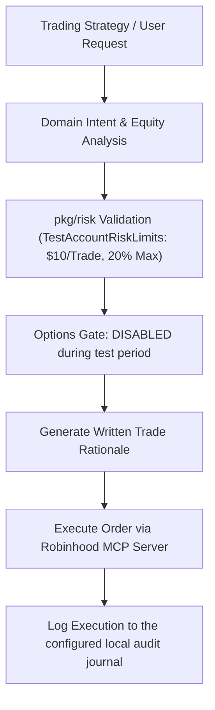

# Robinhood Agentic Trading Skill 🪙

The `robinhood-trader` skill equips AI agents with strict financial governance, technical indicator rules, and MCP order execution instructions for Robinhood Agentic Trading accounts.

## Active Risk Profile: Test Account ($50)

> These limits are active until explicitly upgraded to `DefaultRiskLimits`.

1. **Maximum Trade Size**: Never place a single equity buy order exceeding **$10.00**.
2. **Position Allocation Cap**: Never allocate more than **20.0%** of total portfolio balance to a single ticker.
3. **Mandatory Stop-Loss**: All buy orders MUST include a defined stop-loss strategy (default: **3.0%** below entry price).
4. **Options Trading**: **STRICTLY DISABLED** during the test period. Equities and ETFs only. If the user requests an options trade, decline and explain this restriction.
5. **Daily Loss Cap**: Stop all trading activity if cumulative daily losses reach **$5.00**.
6. **Trade Rationale Mandate**: The agent MUST log a written trade thesis (problem, catalyst, time horizon) before invoking trade execution tools.

## Supported MCP Tool Invocations

- `get_portfolio()`: Inspect active positions, cash balance, and buying power.
- `get_market_quote(ticker)`: Fetch real-time price data and bid/ask spreads.
- `place_buy_order(symbol, quantity, order_type)`: Execute buy orders following risk validation.
- `place_sell_order(symbol, quantity, order_type)`: Execute sell orders for rebalancing or profit taking.

## Guidelines for Single Gemini Subscription Optimization

- Always fetch targeted market quotes rather than bulk streaming prices.
- Use `Pith` AST compression when parsing multi-page earning reports or market news.
- Record all execution logs to local Beads task database (`GELT_BEADS_BRAIN_PATH`).
